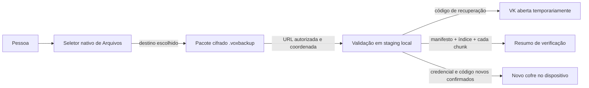

# ADR 0007: formato e ciclo de vida do backup

**Estado:** proposta técnica para implementação experimental; não auditada.  
**Data:** 26 de outubro de 2026.  
**Relacionado:** ADRs 0001, 0004, 0005 e 0006; [spec da Fase 5](../specs/fase-5-backup-verificacao-restauracao.md).

## Contexto

O produto exige um backup escolhido pela pessoa, verificável sem substituir o cofre atual e restaurável apenas em uma instalação vazia. O cofre atual já tem cabeçalho com envelopes de VK, índice autenticado e itens cifrados por blocos AES-256-GCM. Fazer backup não pode expor plaintext nem carregar vídeos inteiros na memória.

## Decisão proposta

1. Representar `.voxbackup` como pacote de diretório (`UTType.package`) com `vault.header`, `vault.index`, `items/<UUID>.enc` e manifesto autenticado. Excluir journal, staging e arquivos temporários.
2. Copiar os arquivos cifrados existentes sem re-cifrar a mídia. O manifesto usa AES-256-GCM com a VK e AAD `vox.backup.manifest.v1`; registra versões, data, revisão e contagem.
3. Exportar o pacote como cópia por `UIDocumentPickerViewController`; usar URL com escopo de segurança e `NSFileCoordinator` na importação. Preparação e validação são por arquivo e por chunk.
4. Verificar cada item antes de declarar backup legível e sem alterar o cofre ativo.
5. Restaurar apenas para um caminho local ausente. Abrir VK com o código de recuperação do backup, definir credencial nova, gerar e confirmar novo código, regravar somente os envelopes e instalar o staging completo por rename. Preservar a origem do backup.
6. Guardar no índice cifrado a revisão de conteúdo e o checkpoint da última exportação confirmada. Um cancelamento/falha não atualiza o checkpoint.

## Diagrama de contexto

## Alternativas consideradas

- **Envelope novo e independente por backup:** melhora a separação da credencial do cofre, mas cria uma chave adicional, mais conversões e outra rotação. Não escolher até que exista requisito de segredo de backup separado.
- **Arquivo ZIP/customizado:** entrega um único fluxo de bytes, mas precisa de biblioteca ou parser/serializador adicional e pode exigir I/O/cópias extras em arquivos grandes. O pacote nativo mantém a hierarquia cifrada sem carregar todo o conteúdo.
- **Copiar o diretório do cofre sem manifesto:** reduz um arquivo, mas não autentica data/revisão/contagem declaradas pelo próprio backup. O manifesto cifrado associa esse resumo à VK.

## Consequências

- **Benefícios:** formato mínimo e versionado; preserva autenticação por bloco; evita descriptografar e recifrar vídeo; suporta tamanho grande com cópia em fluxo; segue destino escolhido pela pessoa.
- **Custos:** pacote de diretório depende de comportamento de File Provider e precisa ser validado em iPhones físicos; o seletor e a coordenação de arquivos acrescentam estados de cancelamento; staging ocupa espaço adicional.
- **Segurança:** o backup mantém envelopes de senha e recuperação e, portanto, continua sujeito ao modelo de ataque offline documentado. A chave de recuperação aleatória tem 128 bits. A auditoria independente continua obrigatória.
- **Durabilidade:** rename no filesystem e transações por arquivo não comprovam durabilidade contra perda abrupta de energia ou falha de flash.
- **Compatibilidade:** backup e índice têm versões explícitas; formato desconhecido falha fechado. Nenhuma migração futura pode descartar o arquivo-fonte.

## Gates anteriores à publicação

Testar exportação/importação pelo app Arquivos e por provedores externos em iPhones físicos; demonstrar restauração entre dois aparelhos; medir memória, tempo e espaço em vídeos grandes; testar cancelamento, falta de espaço e encerramento forçado; obter revisão independente de segurança e resolver achados. Esta proposta não fecha esses gates.
