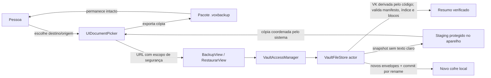

# Especificação — Fase 5: backup, verificação e restauração

**Estado:** especificação para implementação experimental, 26 de outubro de 2026.  
**Decisões-base:** [ADR 0001](../adr/0001-backup-sob-controle-da-pessoa.md), [ADR 0005](../adr/0005-codigo-de-recuperacao-e-restauracao.md), [ADR 0006](../adr/0006-formato-do-cofre-metadados-e-transacoes.md) e [ADR 0007](../adr/0007-formato-e-ciclo-de-vida-do-backup.md).  
**Limite:** não autoriza uso com mídia pessoal, alegações de segurança, beta ou publicação. A revisão independente e os testes em iPhones físicos continuam gates obrigatórios.

## Objetivo

Permitir que a pessoa crie um backup portátil cifrado sob seu controle, confira sua legibilidade sem alterar o cofre atual e restaure os itens desse backup em uma instalação sem cofre. O arquivo escolhido pelo destino e o arquivo-fonte do backup permanecem intactos.

## Escopo funcional

1. Criar um pacote `.voxbackup` a partir do estado persistido do cofre desbloqueado.
2. Exportar o pacote por um seletor nativo de Arquivos, como cópia, para um destino escolhido pela pessoa.
3. Marcar o backup local como concluído somente após o seletor confirmar a cópia. Uma falha, cancelamento ou retorno sem confirmação nunca atualiza o estado para **Atualizado**.
4. Verificar um pacote selecionado sem escrever no cofre ativo, decifrando o índice e autenticando cada bloco de cada item.
5. Restaurar somente quando não existir cofre configurado no destino. Pedir o código de recuperação do backup, definir uma nova credencial principal, gerar e confirmar um novo código de recuperação e só então instalar o novo cofre.
6. Preservar o pacote-fonte, inclusive depois da restauração. Backups anteriores continuam utilizáveis com os segredos que os abriam quando foram criados.

## Formato e chaves

`.voxbackup` é um pacote de diretório identificado pelo UTI exportado `com.voxloop.voxbackup`, que conforma a `package` do sistema. O pacote contém somente:

```text
<nome>.voxbackup/
├── vault.header
├── vault.index
├── backup.manifest
└── items/
    └── <UUID>.enc
```

`vault.header`, `vault.index` e os itens mantêm o formato autenticado já usado pelo cofre. `backup.manifest` contém um `VaultCrypto.SealedValue` cifrado com a VK e AAD `vox.backup.manifest.v1`; o conteúdo autenticado registra a versão do backup, a versão do cofre, data de criação, revisão de conteúdo e quantidade de itens. Não entram no pacote journal, staging, arquivos temporários, segredos em texto claro, biometria, logs nem arquivos de origem.

O pacote conserva os envelopes de credencial e recuperação existentes. Portanto, copiar um backup copia também os envelopes necessários a tentativas offline contra a credencial principal; isso é uma propriedade do modelo aprovado de chave, deve ser explicado e permanece sujeito à auditoria. A recuperação usa o código aleatório de 128 bits do próprio backup. Na restauração, a VK e os DEKs não mudam; são criados envelopes novos para a credencial principal e para um novo código de recuperação. O código e a credencial antigos continuam capazes de abrir os backups que ainda os contêm, mas não o cofre restaurado após a troca dos envelopes.

## Arquitetura



O `VaultFileStore` continua sendo o escritor serial do cofre. A criação prepara um snapshot cifrado em staging local protegido; a UI entrega esse pacote ao seletor por `UIDocumentPickerViewController(forExporting:asCopy:)`. A restauração usa URL de escopo de segurança e coordena a leitura externa com `NSFileCoordinator`; a cópia para staging local é validada antes de qualquer instalação. Os blocos de mídia são copiados por arquivo e autenticados em fluxo; não carregar o backup inteiro na memória.

### Trade-offs revisados

| Opção | Segurança e integridade | Custo/compatibilidade | Decisão |
|---|---|---|---|
| Copiar o formato cifrado existente para pacote | Mantém tags GCM, envelopes e limites atuais; manifesta o risco de ataque offline já presente no contêiner | Sem re-cifrar vídeos; baixo pico de memória; usa pacote de diretório do iOS | Escolhida para o protótipo |
| Criar uma chave e cifragem externa própria por backup | Pode separar credenciais do cofre | Duplica fluxo criptográfico, aumenta CPU/I/O e cria mais formatos e migrações | Rejeitada nesta fase |
| Construir ZIP/arquivo customizado | Pode produzir um único fluxo de bytes | Exige biblioteca ou formato de archive; adiciona cópia/compressão e superfície de parsing | Rejeitada nesta fase |

Para o produto local sem servidor, “escala 10×” não é requisito de backend. O principal limite de escala é arquivo de vídeo grande: cópias em fluxo, espaço livre estimado, progresso e cancelamento são requisitos; pico de memória não deve crescer com o tamanho total do backup.

## Contratos

- **Criar:** verificar estado desbloqueado, ausência de journal pendente, consistência do índice e integridade dos itens; capturar revisão e data; preparar pacote completo em staging; só então apresentar o seletor. Cancelamento limpa staging. Após confirmação da cópia, gravar no índice cifrado a revisão e a data exportadas. Se o conteúdo avançar durante a operação, o estado continua desatualizado.
- **Verificar:** verificar UTI/pacote e estrutura antes de abrir arquivos; rejeitar symlinks, caminhos inesperados, duplicatas, arquivos ausentes/extras e UUIDs divergentes; pedir o código de recuperação; autenticar header, manifesto, índice, DEKs e todos os chunks. Retornar data, contagem e tamanho. Não criar nem substituir o cofre atual.
- **Restaurar:** exigir ausência do cofre e caminho final ainda livre; ler e validar o pacote em staging; gerar envelopes novos e um código novo; preparar um diretório de cofre completo ao lado do destino; aguardar a confirmação do código novo; fazer um único rename do staging validado para o destino local. O código incorreto, cancelamento, falta de espaço, arquivo adulterado ou falha de cópia não modifica o cofre ativo nem o pacote-fonte.
- **Migração do índice:** a revisão de conteúdo e o checkpoint do backup são campos cifrados do índice. Índices v1 existentes são lidos com revisão zero e sem checkpoint e gravados no novo formato em sua próxima transação; nunca descartar itens para migrar.
- **Bloqueio/encerramento:** VK e registros seguem o ciclo de vida atual. Preparações temporárias ficam em diretório protegido, excluído do backup automático e são removidas no cancelamento ou na inicialização seguinte. Limpeza e rename não prometem sobrescrita física nem durabilidade contra falha da flash.

## Segurança e tratamento de erros

- Nunca aceitar um backup só porque JSON, nomes ou tamanhos parecem válidos; o sucesso exige autenticação de todo bloco esperado e correspondência com manifesto e índice.
- Não seguir symlinks nem concatenar caminhos recebidos do pacote. Montar destinos apenas a partir de UUIDs validados e nomes fixos.
- Usar mensagens distintas para credencial de recuperação incorreta, formato incompatível, corrupção/autenticação e falta de espaço, sem expor detalhes de chave ou conteúdo.
- Não escrever o código de recuperação, a credencial, nomes de itens, paths externos ou erro bruto do File Provider nos logs.
- Proteção de arquivo iOS completa e exclusão do backup automático aplicam-se ao staging local. A pessoa escolhe e controla o destino externo.
- O tamanho aproximado e a quantidade de itens do pacote continuam observáveis no destino.

## Critérios de aceite

- [ ] Um backup de zero, um e vários itens inclui somente o layout definido e contém os bytes cifrados originais, sem plaintext de mídia.
- [ ] A cópia do seletor confirmada persiste data/revisão; cancelar, falhar ou interromper não anuncia sucesso.
- [ ] Importar/apagar itens depois do checkpoint marca o estado como desatualizado também após bloquear, encerrar e reabrir o app.
- [ ] Verificação válida devolve manifesto e contagem; backup adulterado, truncado, incompleto, com arquivo extra, nome malicioso ou versão incompatível falha sem escrever no cofre atual.
- [ ] Código incorreto não altera o backup nem o cofre atual; mensagens não confundem falha de autenticação e formato incompatível.
- [ ] Restauração cria um cofre em instalação vazia com nova credencial e código; origens antigas continuam inalteradas; o novo código funciona e o código antigo não abre o cofre novo.
- [ ] Restauração em cofre já configurado é recusada sem sobrescrever ou mesclar; pacote-fonte permanece byte a byte inalterado.
- [ ] Falha/cancelamento em cada etapa antes do rename deixa a instalação vazia e o staging é limpo; falha após commit abre o cofre restaurado após relançar.
- [ ] Testes usam só dados sintéticos; `swift test`, build iOS Simulator, inspeção de acessibilidade e testes físicos permanecem evidências separadas.

## Fora de escopo

Backup automático, sincronização, nuvem Voxloop, compartilhamento, múltiplos cofres, mesclagem, restauração sobre cofre configurado, biometria/Keychain e promessa de recuperação sem o backup.

## Referências técnicas

- [UTType.package — Apple](https://developer.apple.com/documentation/uniformtypeidentifiers/uttypepackage)
- [UIDocumentPickerViewController — Apple](https://developer.apple.com/documentation/uikit/uidocumentpickerviewcontroller)
- [Acesso a diretórios — Apple](https://developer.apple.com/documentation/uikit/providing-access-to-directories)
- [NSFileCoordinator — Apple](https://developer.apple.com/documentation/foundation/nsfilecoordinator)
